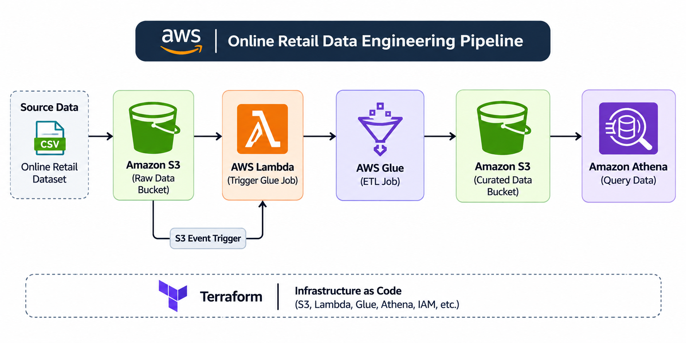

# AWS Online Retail Data Engineering Pipeline

An end-to-end, event-driven AWS Data Engineering project built using **Terraform, Amazon S3, AWS Lambda, AWS Glue, PySpark, and Amazon Athena**.

This project automates the ingestion and transformation of online retail transaction data. When a CSV file is uploaded to Amazon S3, an event notification triggers AWS Lambda, which starts an AWS Glue ETL job. The transformed data is stored in Parquet format and made available for analytics through Amazon Athena.

---

## Architecture



## Project Overview

The objective of this project is to build an automated and scalable cloud-based data pipeline using Infrastructure as Code (IaC).

**Key objectives:**
- Automate raw data ingestion into Amazon S3.
- Trigger ETL jobs using S3 Event Notifications and AWS Lambda.
- Perform data cleaning and transformation using PySpark.
- Store processed data in optimized Parquet format.
- Maintain metadata using AWS Glue Data Catalog.
- Query processed data using Amazon Athena.
- Provision AWS infrastructure using Terraform.

## Technology Stack

| Category | Technology |
|---|---|
| Cloud Platform | Amazon Web Services |
| Infrastructure as Code | Terraform |
| Data Storage | Amazon S3 |
| Event Trigger | S3 Event Notifications |
| Serverless Compute | AWS Lambda |
| ETL Processing | AWS Glue 4.0, PySpark |
| Data Catalog | AWS Glue Data Catalog |
| Metadata Discovery | AWS Glue Crawler |
| Query Engine | Amazon Athena |
| Programming | Python, SQL |
| File Formats | CSV, Parquet |

## Data Pipeline Workflow

1. **Data Ingestion:** Upload the raw Online Retail CSV file into the Amazon S3 raw bucket under the `input/` prefix.

2. **Event Notification:** Amazon S3 detects the newly uploaded CSV file and sends an event notification.

3. **Lambda Execution:** AWS Lambda receives the event and invokes the configured AWS Glue ETL job.

4. **Data Transformation:** AWS Glue executes a PySpark script to clean, validate, and transform the retail transaction data.

5. **Data Storage:** Transformed data is written to the processed S3 bucket in Parquet format.

6. **Data Cataloging:** AWS Glue Crawler scans the processed data and creates table metadata in the Glue Data Catalog.

7. **Data Analytics:** Amazon Athena uses the catalog metadata to query the processed Parquet dataset using SQL.

## Data Transformation

The PySpark ETL job performs the following operations:

- Duplicate record removal.
- Missing value handling.
- Data type conversion.
- Text standardization.
- Invalid transaction filtering.
- Sales and cancellation identification.
- Revenue calculation using Quantity × UnitPrice.
- Processed data generation in Parquet format.

## Dataset Information

**Dataset:** UCI Online Retail Dataset

The original dataset contains 541,909 transaction records and 8 columns.

| Column | Description |
|---|---|
| InvoiceNo | Transaction invoice number |
| StockCode | Product identifier |
| Description | Product description |
| Quantity | Purchased quantity |
| InvoiceDate | Transaction date |
| UnitPrice | Product unit price |
| CustomerID | Customer identifier |
| Country | Customer country |

For development and testing, a 20,000-row sample was processed.

## Data Processing Results

| Metric | Result |
|---|---:|
| Input Records | 20,000 |
| Cleaned Records | 19,549 |
| Sales Revenue | 398,780.14 |
| Cancellation Revenue | -60,367.30 |
| Net Revenue | 338,412.84 |

*Results are based on the 20,000-row development sample. Revenue values are in the dataset's original currency (GBP).*

## Athena SQL Analytics

The processed dataset is available for analytical queries through Amazon Athena.

### 1. Total Processed Records

```sql
SELECT COUNT(*)
FROM online_retail;
```

**Result:** 19,549 records.

### 2. Revenue by Transaction Type

```sql
SELECT
    transaction_type,
    COUNT(*) AS total_transactions,
    ROUND(SUM(revenue), 2) AS total_revenue
FROM online_retail
GROUP BY transaction_type;
```

### 3. Top 10 Countries by Revenue

```sql
SELECT
    country,
    COUNT(*) AS total_transactions,
    ROUND(SUM(revenue), 2) AS total_revenue
FROM online_retail
GROUP BY country
ORDER BY total_revenue DESC
LIMIT 10;
```

### 4. Top Products by Revenue

```sql
SELECT
    stockcode,
    description,
    SUM(quantity) AS total_quantity,
    ROUND(SUM(revenue), 2) AS total_revenue
FROM online_retail
GROUP BY stockcode, description
ORDER BY total_revenue DESC
LIMIT 10;
```

## Terraform Infrastructure

Terraform is used to provision and manage the AWS resources required for the pipeline.

Infrastructure components:

- Amazon S3 raw and processed buckets.
- IAM roles and policies for Lambda and Glue.
- AWS Lambda function and S3 event notification.
- AWS Glue ETL job.
- AWS Glue Data Catalog database.
- AWS Glue Crawler.
- Amazon Athena workgroup and query result location.

## Project Structure

```text
terraform-s3-glue-athena-pipeline/
│
├── lambda/
│   └── trigger_glue.py
│
├── glue-scripts/
│   └── transform.py
│
├── data/
│   └── Sample datasets (excluded from Git)
│
├── providers.tf
├── variables.tf
├── s3.tf
├── iam.tf
├── lambda.tf
├── glue.tf
├── catalog.tf
├── athena.tf
│
├── prepare_sample.py
├── inspect_data.py
├── architecture.png
├── README.md
└── .gitignore
```

## Deployment Guide

### Prerequisites

- AWS Account
- AWS CLI configured
- Terraform installed
- Python installed
- Appropriate AWS IAM permissions

### Step 1: Clone Repository

```bash
git clone https://github.com/shaik-siddiq13/terraform-s3-glue-athena-pipeline.git

cd terraform-s3-glue-athena-pipeline
```

### Step 2: Initialize Terraform

```bash
terraform init
```

### Step 3: Validate Configuration

```bash
terraform validate
```

### Step 4: Review Infrastructure Plan

```bash
terraform plan
```

### Step 5: Prepare Dataset

```bash
python prepare_sample.py
```

### Step 6: Create Lambda Deployment Package

Run in PowerShell:

```powershell
Compress-Archive -Path lambda\trigger_glue.py -DestinationPath lambda.zip -Force
```

### Step 7: Deploy Infrastructure

```bash
terraform apply
```

Review the Terraform plan and potential AWS costs before approving deployment.

### Step 8: Trigger Pipeline

Upload a CSV file to the raw S3 bucket under the `input/` prefix to trigger the automated ETL workflow.

## Key Learning Outcomes

- Building event-driven AWS data pipelines.
- Implementing PySpark ETL transformations.
- Working with S3 storage and Parquet.
- Automating ETL execution using Lambda and Glue.
- Managing metadata using Glue Data Catalog.
- Running analytical SQL queries using Athena.
- Provisioning AWS infrastructure using Terraform and IAM.

## Future Enhancements

- Add automated data quality checks.
- Implement incremental data processing.
- Integrate Apache Airflow for orchestration.
- Implement CI/CD using GitHub Actions.
- Add monitoring and alerting using Amazon CloudWatch.

## Important Notes

- This project uses a 20,000-row development sample.
- The pipeline uses event-driven automated batch processing, not continuous streaming.
- Terraform state files, AWS credentials, datasets, and generated ZIP packages are excluded from Git.
- AWS resources may incur charges.

---

## Author

**Data Engineering Portfolio Project**

Technologies: AWS | Terraform | Python | PySpark | SQL

[GitHub Repository](https://github.com/shaik-siddiq13/terraform-s3-glue-athena-pipeline)